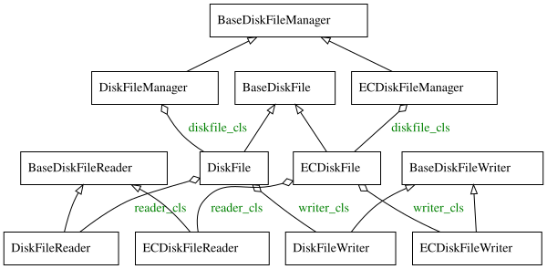

# The Swift Object Backend

Ziv Entin · 2026-07-03

---

# Objectives

- How requests for objects are handled
- How does swift store objects on disk
- What we can do to change this process

---

# Request path
A request for an object goes through several layers before it reaches the disk. The proxy and ring decide where, The object server does as it's told.

---

# The storage classes
When the object server reaches for storage, it uses a DiskFileManager and DiskFiles to do so. This is the part of Swift responsible for disk operations. Swift provides two DiskFile families: one for replication and one for erasure coding. In addition, we can create our own.

---

# What DiskFile does
DiskFile is the interface for an object. It includes a reader, a writer and some direct operations. This interface is also the documented contract any replacement would need to fulfill.

---

# Standard file layout
By default object data is stored in <device>/objects/<partition>/<suffix>/<hash>/<ts>.<ext> under the node's directory. These are examples of how different objects look on disk.

---

# Standard write
Objects are written in steps. First create a temporary file. Second fill it with the objects data. Lastly attach the objects metadata to the file and move it into place.

---

# Standard read
Objects are read by sorting the files within their directory by their timestamps and picking the newest to process.

---

# Safety
Because files are first written to a temporary directory and only moved into the object's directory once complete, the reader never has to fear an incomplete file.

---

# What DiskFileManager does
The object server gets DiskFiles from the Manager through get_diskfile(). But the Manager is called in other ways — shown here as ???.

---

# Non standard functions
While not standardized these are some of the additional functions used on a DiskFileManager. This list is incomplete and may change.

---

# Erasure Coding
When erasure coding is used, more parts are added to the filename: '#<frag>' for the fragment index and '#d' indicating durability. The '#d' is added by an additional commit() step.

---

# Custom DiskFileManager
The DiskFileManager can be replaced if it meets the requirements. Doing so keeps Swift's core strengths, but loses the features that depend on the reference behavior.

---

# Conclusion

- Object storage is controlled by DiskFileManager
- Immutable timestamped storage allows efficent reads/writes
- The DiskFileManger can be swapped at a cost

---

# Q&A
